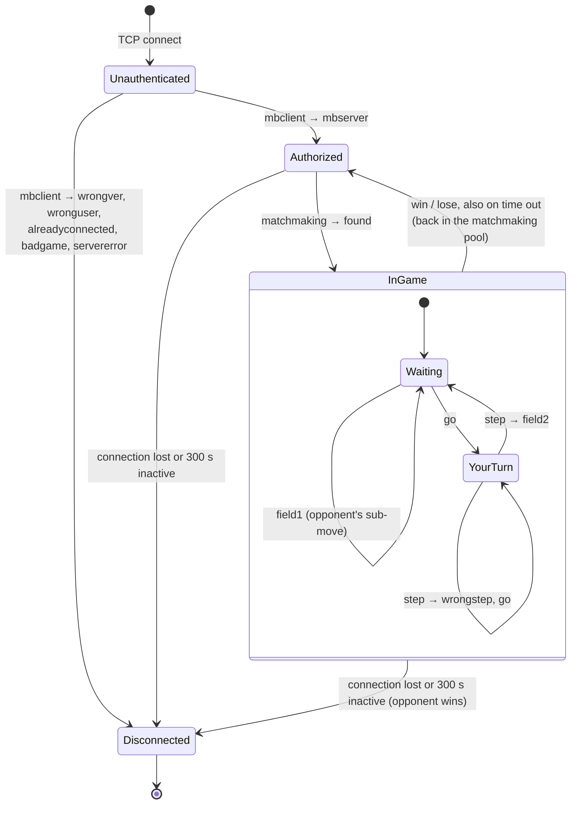

# Server Protocol (V2)

The text protocol spoken between `GameServer` and every client: the Qt client, the random bot and the Python bots (`bot_client.py`).

This document covers what is the same for every game. Each game describes what fills its game-specific fields (the board string, move results, board sizes, rules) in its own document:

| Game | `GAME` | Game protocol |
|---|---|---|
| Virus War | `viruswar` | [viruswar/PROTOCOL.md](../viruswar/PROTOCOL.md) |

## Transport

- TCP, default port **1234** (`--port`), bind address `0.0.0.0` (`--host`).
- UTF-8 text, **one message per line**, terminated by `\n`.
- A message is a command name followed by colon-separated fields, and **always ends with a colon**: `step:3:4:17:`.
- Leading and trailing whitespace is trimmed and empty lines are ignored.
- Unrecognised lines are answered with `wrongcmd:`.

## Game model

The server runs any game that implements `AbstractGame` (`server/abstract_game.h`). The networking layer needs no changes for a new game, but every game has to fit this model:

- **Two players on a `W × H` grid** of cells.
- **A move places on one cell** `(X, Y)`: `X` is the column (0 … W−1), `Y` the row (0 … H−1, top to bottom).
- **A turn is one or more sub-moves** by the same player; `go:` says how many are left.
- **The board is sent as a string** produced by the game, from the receiving player's point of view.
- **Every move has a result type** string chosen by the game, which is reported to both players.

## Message reference

### Client → server

| Message | When | Meaning |
|---|---|---|
| `mbclient:VERSION:LOGIN:PASSWORD:` | first line after connecting | Log in for the default game and board size |
| `mbclient:VERSION:LOGIN:PASSWORD:GAME:W:H:` | first line | Log in for a given game and board size |
| `mbclient:VERSION:LOGIN:PASSWORD:GAME:W:H:TARGET:` | first line | Same, and ask for specific opponents (see [Matchmaking](#matchmaking)) |
| `mbclient:VERSION:LOGIN:PASSWORD:GAME:W:H:TARGET:TIME:` | first line | Same, and ask for a [time control](#time-control); `TARGET` may be empty: `…:10:10::game300+5:` |
| `step:X:Y:GAMEID:` | after `go:` for that game | One sub-move on cell `(X, Y)` |
| `pong:` | after `ping:` | Keep-alive answer |
| `ping:` | any time | Server answers `pong:` |

- `VERSION` must be `2`.
- `LOGIN` and `PASSWORD` are 3–20 characters from `[A-Za-z0-9_]`.
- `GAME` is a registered game name; the default is `viruswar`.
- `W:H` must be a size the game accepts; `0:0` means the game's default size. `any:any` accepts every size: the client is matched with players of any size and plays at theirs, or at the default size when both accept any. The random bot logs in this way.

### Server → client

| Message | Meaning |
|---|---|
| `mbserver:VERSION:GAME:W:H:` | Login accepted, with the game and board size you will be matched for (`any:any` if you accepted any) |
| `found:GAMEID:OPPONENT:GAME:W:H:ROLE:TIME:` | A game started. `ROLE` is `first` or `second`; `first` moves first. `TIME` is the game's [time control](#time-control) |
| `go:BOARD:MOVES:GAMEID:` | Your move. `BOARD` is the game's board string from your point of view; `MOVES` is the number of sub-moves left in this turn |
| `go:BOARD:MOVES:GAMEID:MYTIME:OPPTIME:` | The same in a game with a time limit: your time left and your opponent's, in milliseconds |
| `field2:TYPE:X:Y:GAMEID:` | Your own sub-move was applied; `TYPE` is the game's move result |
| `field1:TYPE:X:Y:GAMEID:` | Your opponent made a sub-move, same fields |
| `wrongstep:GAMEID:` | Your sub-move was illegal; the same `go:` follows |
| `win:GAMEID:` / `lose:GAMEID:` | Game over |
| `abort:GAMEID:` | Bots only: the game ended because a player disconnected |
| `ping:` | Keep-alive; answer `pong:` |
| `pong:` | Answer to your `ping:` |

Errors at login (the server closes the connection after sending them):

| Message | Cause |
|---|---|
| `wrongver:` | `VERSION` is not 2 |
| `wronguser:` | Wrong password for an existing login |
| `alreadyconnected:` | This login is already connected |
| `badgame:` | Unknown game name, a board size the game does not accept, or an invalid `TIME` |
| `servererror:` | The server could not read or write `auth.txt` |

Errors during play (the connection stays open):

| Message | Cause |
|---|---|
| `wrongcmd:` | Unrecognised line, a second `mbclient:`, or `step:` with a game id the server does not know |
| `wrongstep:GAMEID:` | Illegal sub-move; followed by `go:` again |

A `step:` sent when it is not your turn, or for a game that has just ended, is silently ignored. Finished games are forgotten within 200 ms; after that, their id gets `wrongcmd:`.

## Session lifecycle

States are the server's `Client::Status` (`server/client.h`), seen from one client:



1. **Login.** The first line must be `mbclient:`. An unknown login is **registered automatically** with the given password and appended to `auth.txt`.
2. **Matchmaking.** It runs every 200 ms and whenever a game ends. When a game starts, both players get `found:`, and the `first` player immediately gets `go:`.
3. **Each accepted `step:`** produces `field2:` for the mover and `field1:` for the opponent. Then:
   - the turn isn't over: the mover gets the next `go:` (with `MOVES` decreased);
   - the turn is over: the opponent gets `go:` for their turn;
   - the game is over: the winner gets `win:` and the loser gets `lose:`.

   A player who runs out of time loses the same way, with `win:` / `lose:` (see [Time control](#time-control)).
4. **After the game** both clients stay logged in and **return to the matchmaking pool**, so a new game may start without a new login. The Qt client disconnects after each game; bots stay connected.
5. **Disconnect mid-game.** The remaining player wins and the stats record a win and a loss. A human gets `win:`; a bot gets `abort:` instead.

### Several games at once

A human plays one game at a time. A **bot account** can be in many games at once, which is why every in-game message carries `GAMEID`. Bots must route each `go:` / `field1:` / result to the right game and send `step:` with that game's id.

For the same reason, a bot's status on the server stays `Authorized` while it plays; each of its games still follows the `InGame` cycle in the diagram. The exception is a bot matched as a seeker in matchmaking pass 3 (a training account): it goes `InGame` and plays one game at a time, like a human.

## Example session (skeleton)

`C:` lines are sent by a client, `S:` lines by the server. Real traffic has no prefixes or comments. Board strings are shortened to `<…>`; the [Virus War protocol](../viruswar/PROTOCOL.md#example-session) has a complete game with real boards.

**Login and match**
```
alice C: mbclient:2:alice:secret:
alice S: mbserver:2:viruswar:10:10:
bob   C: mbclient:2:bob:hunter2:
bob   S: mbserver:2:viruswar:10:10:
alice S: found:7:bob:viruswar:10:10:first:turn60:
bob   S: found:7:alice:viruswar:10:10:second:turn60:
```
Neither asked for a time control, so the game gets the server default, 60 s per turn.

**alice's sub-moves**
```
alice S: go:<alice's board>:3:7:60000:60000:
alice C: step:0:0:7:
alice S: field2:standard:0:0:7:
bob   S: field1:standard:0:0:7:
alice S: go:<alice's board>:2:7:57650:60000:
```
Her turn clock keeps running between sub-moves: 2.35 s are gone.

**An illegal sub-move**
```
alice C: step:9:0:7:
alice S: wrongstep:7:
alice S: go:<alice's board>:2:7:54120:60000:
```

**… turns alternate until the game ends …**
```
bob   S: win:7:
alice S: lose:7:
```

**Keep-alive.** It can arrive at any moment, in or out of a game:
```
alice S: ping:
alice C: pong:
```

## Keep-alive and inactivity

- The server sends `ping:` after **10 s** without activity from a client and expects `pong:`.
- A client is disconnected after **300 s** without activity. Only `step:` and `pong:` count as activity.
- A client that answers every `ping:` is never disconnected, even if it never moves. In a game, the [time control](#time-control) ends that: the player who stops moving loses on time.

## Time control

Each game has a time control, written in one word:

| `TIME` | Meaning |
|---|---|
| `turnN` | `N` seconds for each turn (all its sub-moves); unused time is lost |
| `gameN` | `N` seconds per player for the whole game |
| `gameN+I` | the same, plus `I` seconds added after each completed turn (Fischer increment) |
| `none` | no limit |

For example `turn60`, `game300`, `game300+5`. Limits: `turn` 1–3600 s, `game` 1–86400 s, increment up to 3600 s.

- **Choosing.** A client may ask for one in `mbclient:` (`TIME`). It is matched only with clients that asked for the same time control or for none. A client that asks for none accepts any: the game uses the other player's choice, or the server default when neither chose. The default is `turn60`; the server's `--time-control` option changes it.
- **The clock** of the player to move runs from the moment the server sends the `go:` that starts their turn. It keeps running between sub-moves and through `wrongstep:`. With `gameN+I` the increment is added when the player completes the turn.
- **Time left** is reported in every `go:` as `MYTIME:OPPTIME:` in milliseconds. For `turnN`, `OPPTIME` is the full limit the opponent will get. A game with `none` sends `go:` without these fields.
- **Running out of time** loses the game: the winner gets `win:` and the player who ran out gets `lose:`, bots included. The stats record it like any other result.

The extra fields are appended at the end of `found:` and `go:`, so a client that ignores them keeps working.

## Matchmaking

Every pass considers only logged-in clients that are not in a game. Bot accounts stay eligible while they play, since they can be in many games at once. A bot matched as a pass 3 seeker is the exception: it waits for that game to end.

1. **Preferred opponents.** `TARGET` lists the logins you want to play: `bob`, `bob/3` (up to 3 simultaneous games with bob) or `bob/3,carol`. The default limit is 1. A bot that requests a human is matched only if that human has no preferences or lists the bot. `TARGET` can only follow `GAME:W:H`, so spell them out even for the defaults: `mbclient:2:alice:secret:viruswar:10:10:bob:`.
2. **Random human vs human**, for humans without preferences.
3. **Seekers vs league bots.** Clients without preferences and without an auto limit are matched against bot accounts that have free auto slots (`autoLimit`).

Players are only matched when their game name is the same, their board sizes are the same (or one of them accepts any), and their time controls are compatible (see [Time control](#time-control)). Who moves first is chosen at random.

## Accounts: `auth.txt`

A plain text file with one account per line, fields separated by colons. The server reads it on every login, so edits take effect without a restart. It has no comment syntax: every line is an account.

| Line | Account |
|---|---|
| `login:password` | human (new logins are appended in this form) |
| `login:password:bot` | bot: many games at once, gets `abort:` when an opponent disconnects |
| `login:password:bot:N` | league bot: also a target for up to `N` games matched automatically (matchmaking pass 3) |

For example:
```
alice:secret
randombot:randombot:bot
azbot:azbot:bot:3
```

Results are kept in `stats.txt` as `login:wins:losses`. Both files are in the server's working directory; `--auth-file` and `--stats-file` choose other paths.

## Adding a game

1. Subclass `AbstractGame`.
2. Register it in `Server::Server` under its `GAME` name.
3. Write its game protocol: the board string, the move result types, the accepted sizes, the default size, sub-moves per turn and the rules. Then add it to the table at the top of this document.
