# Server Protocol (V2)

The text protocol between `GameServer` and every client: the Qt client, the random bot and the Python bots (`bot_client.py`).

This document covers what every game shares. Each game documents its own fields (board string, move results, board sizes, rules):

| Game | `GAME` | Game protocol |
|---|---|---|
| Virus War | `viruswar` | [viruswar/PROTOCOL.md](../viruswar/PROTOCOL.md) |

## Transport

- TCP, default port **1234** (`--port`), bind address `0.0.0.0` (`--host`).
- UTF-8 text, **one message per line**, ending in `\n`.
- A message is a command name and colon-separated fields, and **always ends with a colon**: `step:3:4:17:`.
- Leading and trailing whitespace is trimmed; empty lines are ignored.
- Unrecognised lines, including numbers that are too long, get `wrongcmd:`.
- A line is at most 4096 bytes. A client that sends more without a newline is disconnected.
- A connection must log in with a valid `mbclient:` within 10 s or it is closed. An invalid line before that only gets `wrongcmd:`. After a login error, the rest of the same packet is ignored.

## Game model

The server runs any game that implements `AbstractGame` (`server/abstract_game.h`). A new game needs no networking changes, but must fit this model:

- **Two players on a `W × H` grid.**
- **A move places on one cell** `(X, Y)`: `X` is the column (0 … W−1), `Y` the row (0 … H−1, top to bottom).
- **A turn is one or more sub-moves** by the same player; `go:` says how many are left.
- **The board is a string** made by the game, from the receiving player's point of view.
- **Every move has a result type**, a string chosen by the game and reported to both players.

## Message reference

### Client → server

| Message | When | Meaning |
|---|---|---|
| `mbclient:VERSION:LOGIN:PASSWORD:` | first line after connecting | Log in for the default game and board size |
| `mbclient:VERSION:LOGIN:PASSWORD:GAME:W:H:` | first line | Log in for a given game and board size |
| `mbclient:VERSION:LOGIN:PASSWORD:GAME:W:H:TARGET:` | first line | Same, and ask for specific opponents (see [Matchmaking](#matchmaking)) |
| `mbclient:VERSION:LOGIN:PASSWORD:GAME:W:H:TARGET:TIME:` | first line | Same, and ask for a [time control](#time-control); `TARGET` may be empty: `…:10:10::game300+5:` |
| `step:X:Y:GAMEID:` | after `go:` for that game | One sub-move on cell `(X, Y)` |
| `resign:GAMEID:` | any time during that game | Give up: you lose with cause `resign` |
| `nomatch:` | after logging in | No new games; games in progress are played to the end, then the client may disconnect |
| `pong:` | after `ping:` | Keep-alive answer |
| `ping:` | any time | Server answers `pong:` |

- `VERSION` must be `2`.
- `LOGIN` and `PASSWORD`: 3–20 characters from `[A-Za-z0-9_]`.
- `GAME`: a registered game name; default `viruswar`.
- `W:H`: a size the game accepts; `0:0` means the game's default. `any:any` accepts every size: you play at the opponent's size, or at the default when both accept any. The random bot logs in this way.

### Server → client

| Message | Meaning |
|---|---|
| `mbserver:VERSION:GAME:W:H:` | Login accepted, with the game and board size you will be matched for (`any:any` if you accepted any) |
| `found:GAMEID:OPPONENT:GAME:W:H:ROLE:TIME:` | A game started. `ROLE` is `first` (moves first) or `second`. `TIME` is the [time control](#time-control) |
| `go:BOARD:MOVES:GAMEID:` | Your move. `BOARD` is the board from your point of view; `MOVES` is the sub-moves left in this turn |
| `go:BOARD:MOVES:GAMEID:MYTIME:OPPTIME:` | The same in a timed game: your time left and your opponent's, in milliseconds |
| `field2:TYPE:X:Y:GAMEID:` | Your sub-move was applied; `TYPE` is the game's move result |
| `field1:TYPE:X:Y:GAMEID:` | Your opponent made a sub-move, same fields |
| `wrongstep:GAMEID:` | Your sub-move was illegal; the same `go:` follows. The connection stays open |
| `win:GAMEID:CAUSE:` / `lose:GAMEID:CAUSE:` | Game over, with the [cause](#how-a-game-ends) |
| `abort:GAMEID:` | Bots only, instead of `win:`: the opponent disconnected |
| `ping:` | Keep-alive; answer `pong:` |
| `pong:` | Answer to your `ping:` |

`TIME` in `found:`, the clock fields in `go:` and `CAUSE` in `win:` / `lose:` are appended at the end, so a client that ignores trailing fields keeps working.

Login errors (the server then closes the connection):

| Message | Cause |
|---|---|
| `wrongver:` | `VERSION` is not 2 |
| `wronguser:` | Wrong password for an existing login |
| `alreadyconnected:` | This bot login is already connected. A human login with the right password replaces its old connection instead |
| `badgame:` | Unknown game name, a board size the game does not accept, or an invalid `TIME` |
| `servererror:` | The server could not read or write `auth.txt` |

During play, `wrongcmd:` (connection stays open) answers an unrecognised line, a second `mbclient:`, or a `step:` / `resign:` with a game id the server does not know.

A `step:` when it is not your turn, or a `step:` / `resign:` for a game that just ended or that you are not playing, is silently ignored. Finished games are forgotten within 200 ms; after that their id gets `wrongcmd:`.

## Session lifecycle

States are the server's `Client::Status` (`server/client.h`), seen from one client:

```mermaid
stateDiagram-v2
    [*] --> Unauthenticated: TCP connect
    Unauthenticated --> Authorized: mbclient → mbserver
    Unauthenticated --> Disconnected: mbclient → wrongver, wronguser,<br/>alreadyconnected, badgame, servererror,<br/>or no valid mbclient within 10 s
    Authorized --> InGame: matchmaking → found
    state InGame {
        [*] --> Waiting
        Waiting --> YourTurn: go
        Waiting --> Waiting: field1 (opponent's sub-move)
        YourTurn --> YourTurn: step → field2, go (sub-moves left)<br/>step → wrongstep, go
        YourTurn --> Waiting: step → field2 (turn over)
    }
    InGame --> Authorized: win / lose: rules, timeout, resign<br/>(back in the matchmaking pool; humans after 2 s)
    InGame --> Disconnected: connection lost, 300 s inactive<br/>or replaced (opponent wins: disconnect)
    Authorized --> Disconnected: connection lost, 300 s inactive or replaced
    note right of Authorized
        After nomatch the client stays
        logged in but is never matched again
    end note
    Disconnected --> [*]
```



1. **Login.** The first line must be `mbclient:`. An unknown login is **registered automatically** with the given password and appended to `auth.txt`.
2. **Matchmaking** runs every 200 ms and whenever a game ends. When a game starts, both players get `found:` and the `first` player gets `go:` at once.
3. **Each accepted `step:`** sends `field2:` to the mover and `field1:` to the opponent. Then:
   - turn not over: the mover gets the next `go:` (`MOVES` one lower);
   - turn over: the opponent gets `go:` for their turn;
   - game over: the winner gets `win:`, the loser `lose:`.
4. **After the game** both clients stay logged in and **return to the matchmaking pool**. A human is not matched again for 2 s, so a client that leaves after each game (as the Qt client does) is gone before a new game could start. Bots are matched again at once.
5. **Leaving mid-game.** Send `resign:` first: you get `lose:…:resign:`, your opponent `win:…:resign:`. If the connection just drops, the opponent wins with cause `disconnect`. The Qt client asks for confirmation, then resigns.
6. **Shutting down gracefully.** Send `nomatch:`: the server stops matching the client, which finishes its games and disconnects. The bots do this on Ctrl+C. It can't be undone; log in again to be matched again.

### How a game ends

Every ending sends `win:GAMEID:CAUSE:` to the winner and `lose:GAMEID:CAUSE:` to the loser, and the stats record a win and a loss.

| `CAUSE` | The loser… |
|---|---|
| `rules` | lost by the game's rules (Virus War: can't make a full turn) |
| `timeout` | ran out of time ([Time control](#time-control)) |
| `resign` | sent `resign:` |
| `disconnect` | lost the connection, was inactive for 300 s, or logged in again from a new connection; only the winner is told, and a bot winner gets `abort:GAMEID:` instead of `win:` |

### Several games at once

A human plays one game at a time. A **bot account** can play many games at once, which is why every in-game message carries `GAMEID`. Bots must route each `go:` / `field1:` / result to the right game and send `step:` with that game's id.

So a bot's server status stays `Authorized` while it plays; each of its games still follows the `InGame` cycle in the diagram. The exception is a bot matched as a seeker in matchmaking pass 3 (a training account): it goes `InGame` and plays one game at a time, like a human.

## Example session (skeleton)

`C:` lines are sent by a client, `S:` lines by the server; real traffic has no prefixes or comments. Boards are shortened to `<…>`; the [Virus War protocol](../viruswar/PROTOCOL.md#example-session) has a complete game with real boards.

**Login and match**
```
alice C: mbclient:2:alice:secret:
alice S: mbserver:2:viruswar:10:10:
bob   C: mbclient:2:bob:hunter2:
bob   S: mbserver:2:viruswar:10:10:
alice S: found:7:bob:viruswar:10:10:first:turn60:
bob   S: found:7:alice:viruswar:10:10:second:turn60:
```
Neither asked for a time control, so the game gets the server default, 60 s per turn.

**alice's sub-moves**
```
alice S: go:<alice's board>:3:7:60000:60000:
alice C: step:0:0:7:
alice S: field2:standard:0:0:7:
bob   S: field1:standard:0:0:7:
alice S: go:<alice's board>:2:7:57650:60000:
```
Her turn clock keeps running between sub-moves: 2.35 s are gone.

**An illegal sub-move**
```
alice C: step:9:0:7:
alice S: wrongstep:7:
alice S: go:<alice's board>:2:7:54120:60000:
```

**… turns alternate until the game ends …**
```
bob   S: win:7:rules:
alice S: lose:7:rules:
```

**Keep-alive**, at any moment, in or out of a game:
```
alice S: ping:
alice C: pong:
```

## Keep-alive and inactivity

- After **10 s** without activity from a client, the server sends `ping:` and expects `pong:`.
- After **300 s** without activity, the client is disconnected. Only `step:`, `resign:`, `nomatch:` and `pong:` count as activity.
- So a client that answers every `ping:` is never disconnected, even if it never moves. In a game, the [time control](#time-control) handles that: the player who stops moving loses on time.

## Time control

Each game has a time control, written as one word:

| `TIME` | Meaning |
|---|---|
| `turnN` | `N` seconds for each turn (all its sub-moves); unused time is lost |
| `gameN` | `N` seconds per player for the whole game |
| `gameN+I` | the same, plus `I` seconds after each completed turn (Fischer increment) |
| `none` | no limit |

Examples: `turn60`, `game300`, `game300+5`. Limits: `turn` 1–3600 s, `game` 1–86400 s, increment up to 3600 s.

- **Choosing.** A client may ask for one with `TIME` in `mbclient:` (`none` counts as a choice). It is matched only with clients that chose the same or sent no `TIME`. A client without `TIME` accepts any: the game uses the other player's choice, or the server default if neither chose. The default is `turn60` (server option `--time-control`).
- **The clock** of the player to move starts when the server sends the `go:` that starts their turn. It keeps running between sub-moves and through `wrongstep:`. With `gameN+I` the increment is added when the player completes the turn.
- **Time left** is in every `go:` as `MYTIME:OPPTIME:`, in milliseconds. For `turnN`, `OPPTIME` is the full limit the opponent will get. With `none`, `go:` has no clock fields.
- **Running out of time** loses with cause `timeout` (`win:GAMEID:timeout:` / `lose:GAMEID:timeout:`), bots included.

## Matchmaking

Each pass considers only logged-in clients that are not in a game and have not sent `nomatch:`. Bots stay eligible while they play (see [Several games at once](#several-games-at-once)); a pass 3 seeker waits for its game to end.

1. **Preferred opponents.** `TARGET` lists the logins you want to play: `bob`, `bob/3` (up to 3 simultaneous games with bob) or `bob/3,carol`. The default limit is 1. Both sides must agree: a target with preferences of its own is matched only if it lists the requester, and then the lower of the two limits applies. `TARGET` must follow `GAME:W:H`, so spell those out even for the defaults: `mbclient:2:alice:secret:viruswar:10:10:bob:`.
2. **Random human vs human**, for humans without preferences.
3. **Seekers vs league bots.** Clients without preferences and without an auto limit are matched against bot accounts with free auto slots (`autoLimit`).

Players are matched only with the same game name, the same board size (or one accepts any) and compatible time controls (see [Time control](#time-control)). Who moves first is random.

## Accounts: `auth.txt`

One account per line, fields separated by colons. The server reads the file on every login, so edits take effect without a restart. There is no comment syntax: every line is an account.

| Line | Account |
|---|---|
| `login:password` | human |
| `login:password:bot` | bot: many games at once, gets `abort:` when an opponent disconnects |
| `login:password:bot:N` | league bot: also a target for up to `N` automatic games (matchmaking pass 3) |

Example:
```
alice:secret
randombot:randombot:bot
azbot:azbot:bot:3
```

Passwords are stored as salted hashes (`pbkdf2_sha256$ITERATIONS$SALT$KEY`). New accounts are written hashed, and a password typed into the file by hand is replaced by its hash on the account's first successful login. The protocol itself sends passwords in plain text, so use it on a trusted network.

Results go to `stats.txt` as `login:wins:losses`. Both files live in the server's working directory; `--auth-file` and `--stats-file` choose other paths.

## Adding a game

1. Subclass `AbstractGame`.
2. Register it in `Server::Server` under its `GAME` name.
3. Write its game protocol: board string, move result types, accepted sizes, default size, sub-moves per turn and rules. Add it to the table at the top of this document.
